<div align="center">

<a href="https://wikiscroll.com">
  <picture>
    <source media="(prefers-color-scheme: dark)" srcset="docs/images/wordmark-dark.svg">
    
  </picture>
</a>

**Turn doomscrolling into discovery.**<br>
A calm, swipeable reader for Wikipedia and Wikivoyage, with no engagement-driven recommendations.<br>
Millions of ready-made cards in 15 languages, served from a library rebuilt every week.

[**Open wikiscroll.com →**](https://wikiscroll.com)

[How it works](docs/ARCHITECTURE.md) · [Engineering notes](docs/ENGINEERING.md) · [Run it yourself](docs/DEVELOPMENT.md) · [Make it your own](docs/DEVELOPMENT.md#make-it-your-own)

<br>


<picture>
  <source media="(prefers-color-scheme: light)" srcset="docs/images/light-desktop.jpg">
  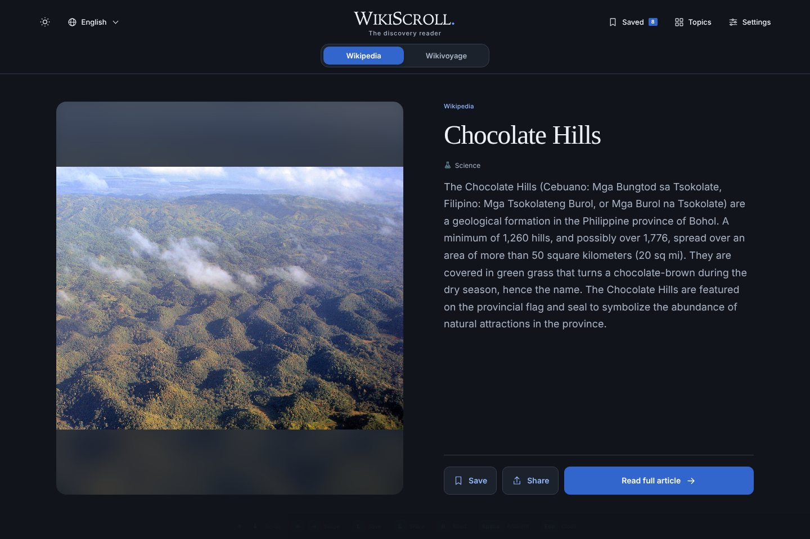
</picture>

</div>

## Why WikiScroll

Spare moments can go to an endless stream of reactions and headlines, or to something worth knowing. WikiScroll shows one article at a time: a photo, a title and an introduction trimmed to whole sentences. Read it, save it, open the full article, or move on.

A few deliberate choices shape the experience:

- **Saves never steer.** Saving an article adds it to your library. It does not change what comes next. Nothing you save, skip or read is sent with a feed request, and [tests](test/randomness.test.js) check that.
- **You choose the filters.** Discovery is random within the topics, depth, language and travel filters you set, and nothing else.
- **No streaks, targets or accounts.** A small daily count and a weekly chart show your reading without turning it into a goal. Everything stays in your browser.

WikiScroll is an independent project. It is not affiliated with or endorsed by the Wikimedia Foundation. Articles belong to their Wikipedia and Wikivoyage authors, and every card links to the original.

## Two ways to explore

<table>
<tr>
<td width="50%" valign="top">

### Wikipedia · *Discover knowledge*

Random articles with a photo and a readable introduction.

- **Topics:** choose any of 12 subjects (Space, Architecture, Music, Biology, Food, Science, History, Geography, Arts, Technology, People, Sports) or none for a random mix.
- **Article depth:** five steps, from *Popular* (Wikipedia's Level 3 vital articles) and *Known* (Level 4) to *Balanced*, *Niche* and *Obscure*. The last three are based on 14-day readership, adjusted for each language edition's audience size.
- **Help Wikipedia** (English, German, French, Spanish): label cards that need citations or updates, or show only those articles. Each label links to the article so you can improve it.

</td>
<td width="50%" valign="top">

### Wikivoyage · *Explore places*

Community-written travel guides to destinations around the world.

- **Browse:** guides are drawn at random from the prebuilt library, like Wikipedia cards. Guides without a photo are hidden unless you turn on *Guides without photos* in Settings or search for a place.
- **Travel filters:** one or more places separated by commas ("Japan, Tuscany"), and a trip style: big cities, small towns, islands, beaches, mountains, national parks, hiking, diving or World Heritage, picked from a sheet that opens from one row. Styles are tagged each week from what each place is (Wikidata facts such as its type, population, coast and World Heritage status, plus Wikivoyage's own article types and section headings), so a state or a country never shows up as a city break or a beach. Destination matching checks the guide’s location hierarchy, with conservative text matching when hierarchy data is unavailable. Selected places take turns in the feed. When every match has been shown, the feed says so and offers the next step: the same place in any style, all destinations, or new filters. Trip styles come from the prebuilt card library; place search runs live, and if it is unavailable, a prebuilt place index built from Wikivoyage's region hierarchy takes over.
- **Map:** open any guide on a map. WikiScroll uses the guide's own coordinates and falls back to a place-name search.
- **12 editions:** in languages without a large Wikivoyage (Arabic, Korean, Hindi), guides are shown in English with a note.

</td>
</tr>
</table>

<p align="center">
  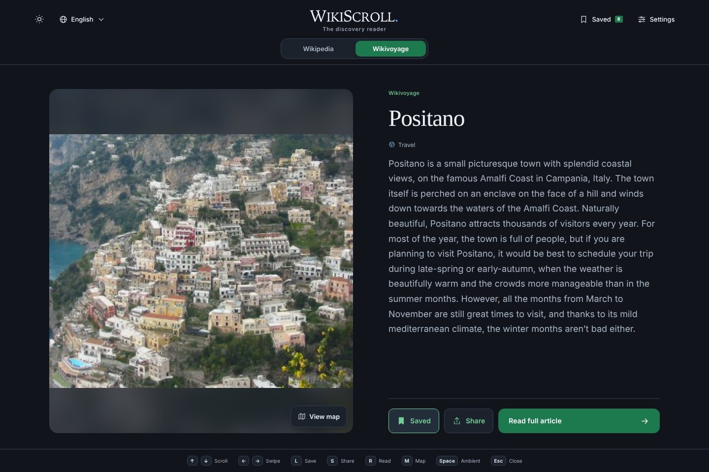
</p>

## Help Wikipedia

Wikipedia is written by volunteers, and much of it still needs work. Editors mark articles that lack sources, need more citations, are out of date or are only a stub, and those marks put each article into hidden maintenance lists. WikiScroll reads those lists so that curiosity can turn into a small contribution. You may be the reader who knows a good source for the lake you just learned about.

In **Settings → Discovery → Help Wikipedia** there are three choices:

- **Off** (default): discovery as usual.
- **Show tags:** cards that need work get a small tag next to their category, naming the most useful fix (*Needs citations*, *Needs copy editing*, *Needs clarification*, *Photo requested*, *Needs updating*, *Needs more detail* or *Short article*). The tag links straight to the article on Wikipedia.
- **Only these articles:** choose maintenance types, with all available types initially selected. English offers citations, photos, copy editing, clarity, updates and more detail; other supported editions show the types available from their maintenance lists. The feed is filled with articles that need work, sampled from random points across Wikipedia's maintenance lists. It combines with topics and depth, so you can look for, say, history articles that need citations.

<p align="center">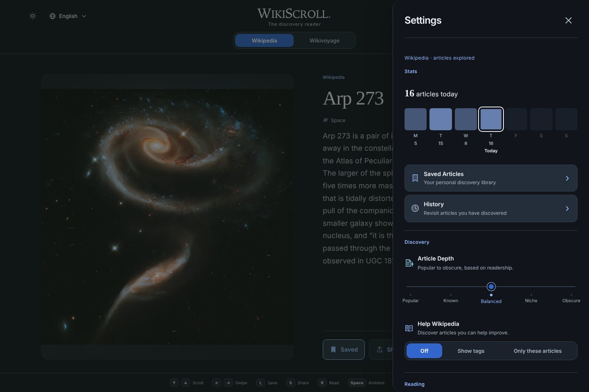</p>

Help Wikipedia is available for English, German, French and Spanish Wikipedia, the editions whose maintenance lists are large and flat enough to sample reliably. English offers every type; German, French and Spanish offer the types their maintenance categories support. WikiScroll doesn't edit anything itself: improvements happen on Wikipedia, under its own guidelines. Tags come from the weekly library build, so a recently fixed article may still show one for up to a week or so.

English also includes requests for copy editing, clarification and photographs. Photo requests come from Wikipedia's talk-page categories and are linked back to the article; an absent thumbnail by itself is never considered an editing request. Only these articles honors selected topics and the depth setting, and resumes unfinished source lookups after a temporary delay.

## On phones

The same reader adapts to a portrait screen, with full-page settings and cards that fit without inner scrolling. Swipe right to save, swipe left to skip, and tap the photograph to inspect it.

<table>
<tr>
<td align="center" width="33%">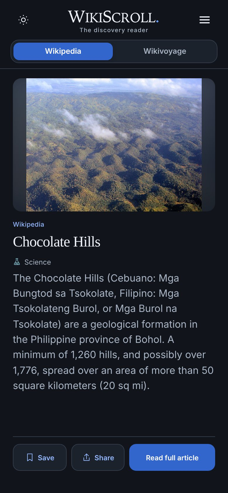<br><sub>Wikipedia</sub></td>
<td align="center" width="33%">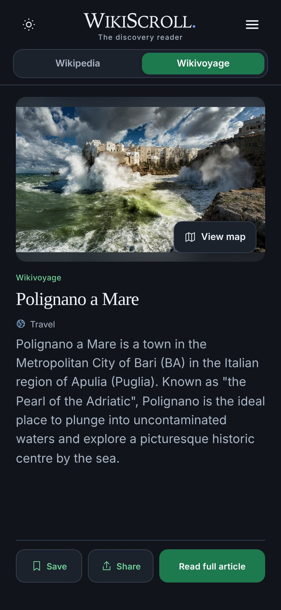<br><sub>Wikivoyage</sub></td>
<td align="center" width="33%">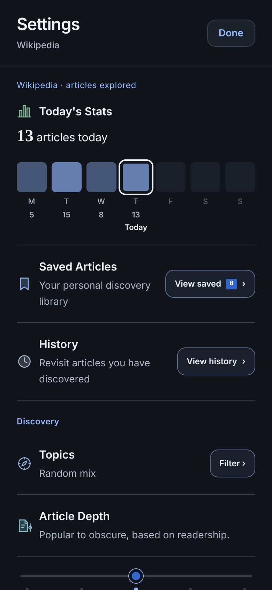<br><sub>Settings</sub></td>
</tr>
</table>

### See the reader move

These demos use the current app and a few real cards from the card library. Desktop uses the right arrow; mobile uses a touch swipe. Saving does not personalize subsequent discovery. The inline previews run at 50 fps; open the videos below for 60 fps playback.

<table>
<tr>
<td align="center" width="68%">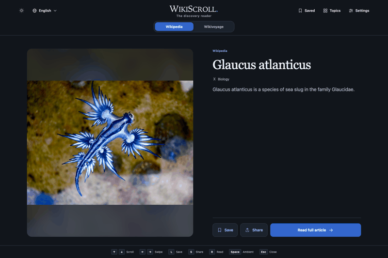</td>
<td align="center" width="32%">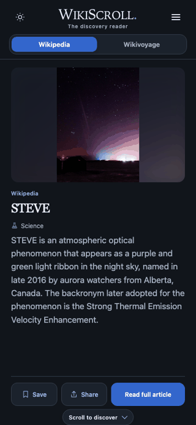</td>
</tr>
</table>

[**Play desktop demo · 60 fps**](docs/demos/swipe-desktop-60fps.mp4) · [**Play mobile demo · 60 fps**](docs/demos/swipe-mobile-60fps.mp4)

## Ambient reading

Press <kbd>Space</kbd> on desktop, or long-press a card on a phone, and everything else steps back: the introduction is set in large serif type over a dimmed version of the article's photo. Press <kbd>Space</kbd> again or tap anywhere to return. Ambient Mode is enabled by default and can be switched off in Settings.

<p align="center">
  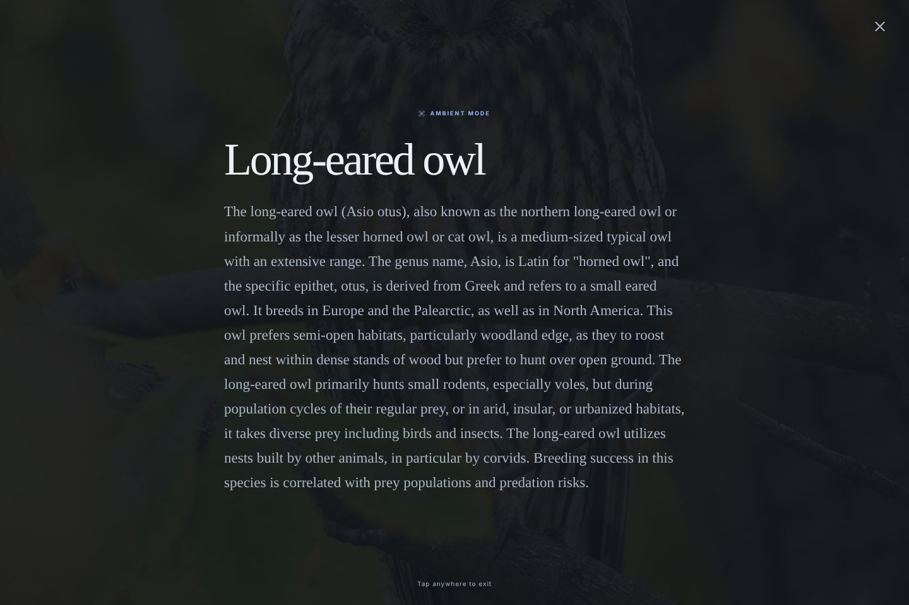
</p>

## Reading preferences

Settings offers Standard, Large and Larger excerpt text. The introduction refits to the card without scrolling inside it, and the preference also applies to Ambient Mode. Optional image dimming works in dark mode and is off by default. Tap a card image, or focus it and press Enter, to inspect it in a separate viewer; the original article links to its image credits.

## Collections you can share

Group saved articles into named collections, and share one as a link. The link opens a page on wikiscroll.com where every title, excerpt and image has been checked again against Wikimedia. Recipients can save their own copy, and messaging apps show a generated preview card.

<table>
<tr>
<td align="center" width="65%">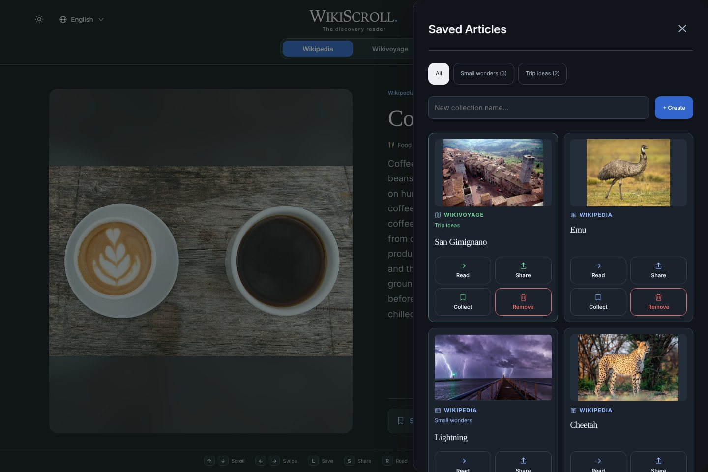</td>
<td align="center" width="35%">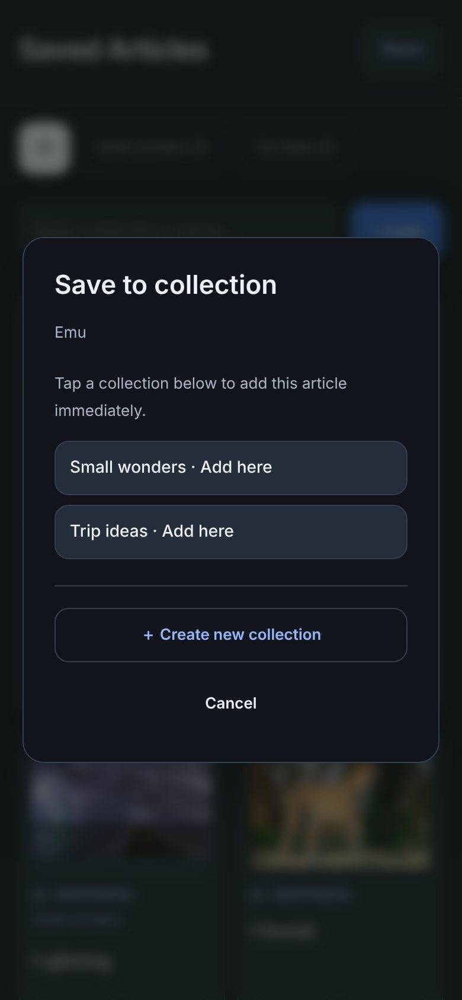</td>
</tr>
</table>

<details>
<summary><b>More of the interface</b></summary>

| Topics | Adding to a collection |
|---|---|
| 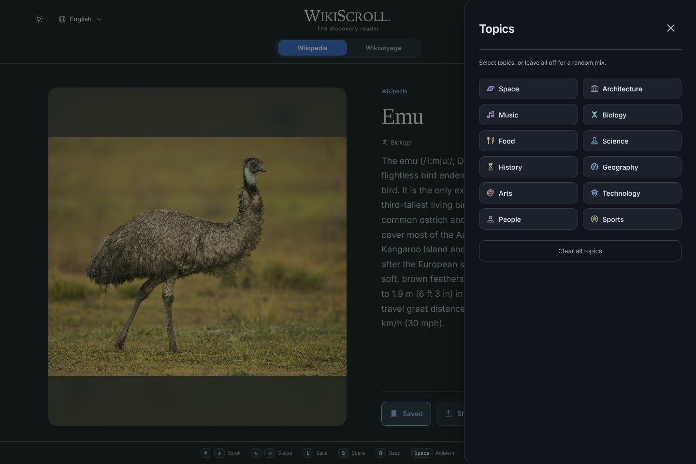 | 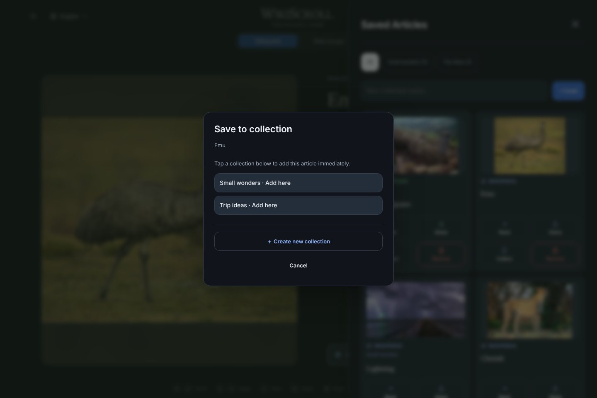 |

| Saved on mobile | Ambient reading on mobile | Light theme on mobile |
|---|---|---|
| 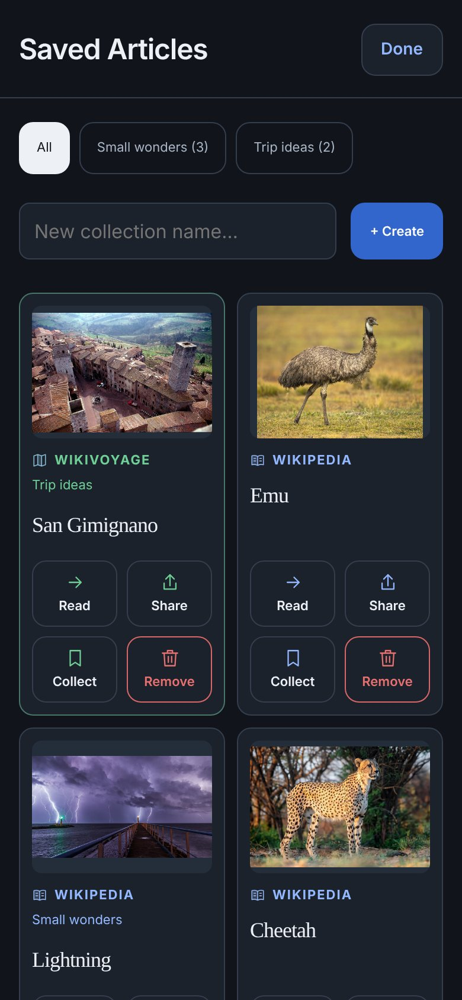 | 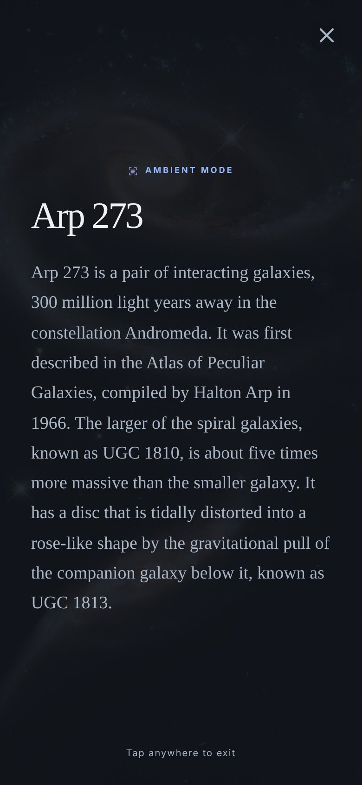 | 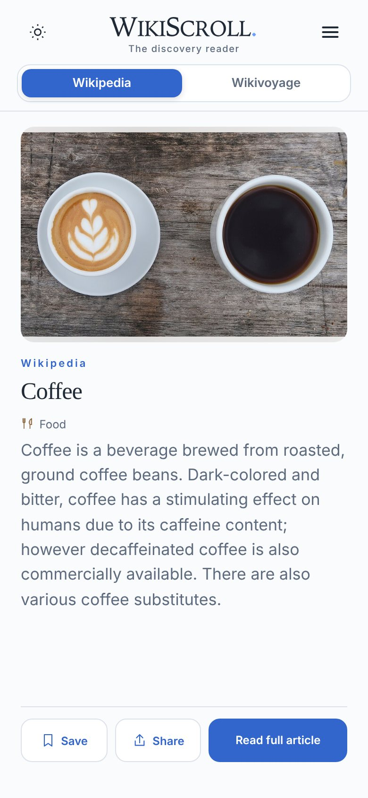 |

| Light theme on desktop |
|---|
| 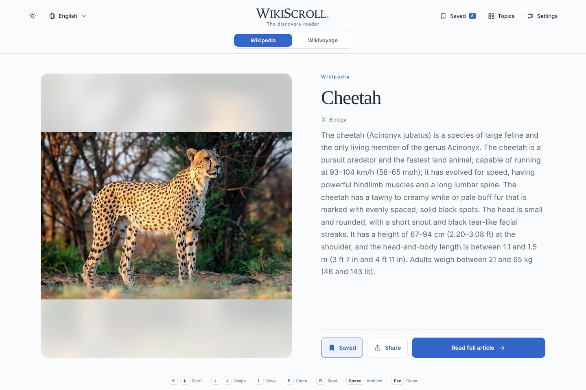 |

</details>

## Features

| | |
|---|---|
| **Reading** | Full-height cards with introductions trimmed to whole sentences that fit the screen. Ambient mode. An occasional "On this day" badge marks people and events tied to today's date. |
| **Mature topics** | Articles on adult and sensitive subjects are hidden by default. *Settings → Mature topics* shows them. Library cards are flagged from their categories; live and starter cards from their title and description. |
| **Your library** | Saved articles (also kept in IndexedDB for offline reading), reading history for the last 50 articles, and named collections, with undo when one is deleted. |
| **Sharing** | Article links get a proper preview in messaging apps. Collections are shared as a snapshot of up to 30 articles, verified again when the link is opened. |
| **Languages** | 15 content languages, and the interface translated into all of them. Each reader downloads only their own language. Arabic and Hebrew get a right-to-left layout. |
| **Input** | Touch swipes, double-tap to save, pull to refresh, two-finger trackpad swipes, and keyboard shortcuts. Desktop text selection and image dragging retain their native behavior. |
| **Install and offline** | Installable as a Progressive Web App. The app shell and recently viewed images are cached, so saved articles and cached content work offline. A bundled backup pool in every language covers openings with no connection. New discoveries and maps need a connection. |
| **Appearance** | Dark theme by default, with a light theme. Responsive layouts for phones, tablets and wide desktops. |

<details>
<summary><b>Keyboard shortcuts</b></summary>

| Key | Action |
|---|---|
| <kbd>↓</kbd> / <kbd>↑</kbd> | Next / previous card |
| <kbd>→</kbd> / <kbd>←</kbd> | Save and continue / skip |
| <kbd>L</kbd> | Save or unsave |
| <kbd>S</kbd> | Share |
| <kbd>R</kbd> | Read the full article |
| <kbd>M</kbd> | Map (Wikivoyage) |
| <kbd>Space</kbd> | Ambient mode |
| <kbd>Esc</kbd> | Close panels and dialogs |

Shortcuts are ignored while a panel or dialog is open, while typing, and when a modifier key is held, so browser shortcuts keep working.

</details>

## Designed with care

The interface is meant to feel calm and predictable. A lot of that comes from small details:

- **The visible card is protected.** Swipes, resizes, rotations and background clean-up never move you away from the article you are reading. If the next card isn't ready, a swipe springs back instead of showing an empty screen.
- **Gestures do one thing.** A trackpad swipe and its momentum count as one action. Swiping right or double-tapping only ever saves; it never removes a save. Vertical scrolling, pinch-zoom and small movements don't trigger anything.
- **Text fits the space.** Introductions are measured against the room available and cut at sentence boundaries (using `Intl.Segmenter` where available), in cards and in ambient mode, so there is no hidden scrolling and no text cut mid-line.
- **Accessibility.** Native `<dialog>` modals with Escape and outside-click dismissal, and focus returns to the button that opened them. Closed drawers are made `inert`; an open drawer takes keyboard focus and gives it back when it closes; and only the card on screen is in the Tab order. The feed is the page's main landmark, and menu buttons announce whether their panel is open. Switches and radio groups use proper ARIA roles and states. Notifications are announced with `role="status"`. Form inputs are at least 16 px, and pinch-zoom is never disabled.
- **Reduced motion.** With `prefers-reduced-motion`, transitions, card flights, smooth scrolling and map fly-to animations are replaced by instant changes.
- **Translations stay local.** Interface labels and messages are translated from bundled dictionaries in the browser. Article text is never sent to a translation service, and in Arabic and Hebrew the interface is right-to-left while each article keeps its own direction.

## How it works

WikiScroll used to build every card on demand from the Wikipedia API. That worked, but it left the feed at the mercy of an API that can be slow, rate-limited or briefly down. Now the cards are **built ahead of time**: once a week, a job turns Wikimedia's public data dumps into a ready-made card library, and the browser downloads cards straight from it. The live API is only a fallback.

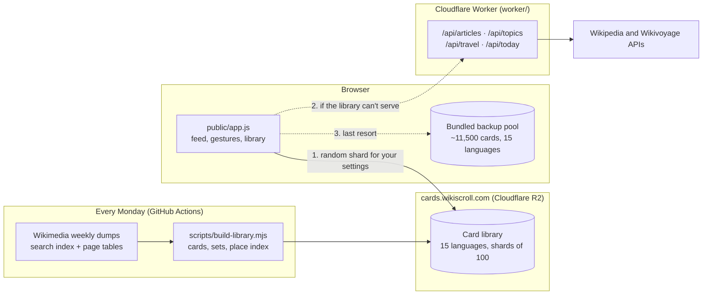

### The card library

- **What's in it.** For each of the 15 languages, a set of cards for every feed the site offers: each article depth, each topic at each depth, each Help Wikipedia type, topics combined with Help types, Wikivoyage guides, and a travel place index. A card holds the title, the introduction (never shortened to save space), a link to the lead photo on Wikimedia, maintenance tags and a mature-topic flag. Photos are not copied; they load from Wikimedia as before.
- **How it's built.** `.github/workflows/card-library.yml` runs early every Monday, the day after Wikimedia publishes its weekly search-index dump. It reads readership from the dump to sort articles into depths, walks the category tree for topics, reads hidden maintenance categories for Help Wikipedia, and fills photoless travel guides from their page banner or the matching Wikipedia photo. Every set is shuffled and packed into gzipped shards of 100 cards.
- **How often.** English is rebuilt every week. The other 14 languages take turns, five a week, so each is rebuilt about every three weeks. Cards are therefore up to about a week old in English and a few weeks old elsewhere, which suits an encyclopedia.
- **How the reader uses it.** The browser reads a small manifest for its language, then downloads one random shard of the set that matches your settings, directly from `cards.wikiscroll.com`. Each visit draws a shard only once. When a setting runs thin, the next draw borrows the nearest depth from the library; when every card for a setting has been shown, the feed ends on a "You're all caught up" card with *Start over* and *Change settings*.
- **Travel.** Korean, Arabic and Hindi have no Wikivoyage, so they use the English guides. Travel search stays live, because it has to match free-text places; when it fails, the prebuilt place index (built from Wikivoyage's region hierarchy, so Japan lists Kyoto through Kansai) answers instead.

### When something fails

Every layer has a fallback, so a reader never sees an empty screen:

1. **Card library** (normal path). A failed download is retried a minute later; a language whose library isn't uploaded yet is retried after 30 minutes.
2. **Cloudflare Worker and the live Wikipedia API.** Serves "On this day", live travel search, and anything the library can't (for example, a failed download). It caches batches at the edge and keeps serving yesterday's cards during a Wikimedia outage.
3. **Wikimedia directly from the browser,** if the Worker itself can't be reached.
4. **The bundled backup pool.** About 11,500 cards in all 15 languages, sampled from the library and shipped with the site, used for offline openings and outages. Each device saves a few shards for its own language.

A build that comes out thin, misreads a table, or finds too many broken image links fails before anything is uploaded, and the current library keeps serving.

### Kept inside the free tier

The library is designed to cost nothing to run, with hard guards against a surprise bill:

- Card downloads go straight to R2 and never pass through the Worker, so they don't count against its daily request limit. Shards never change once uploaded and are cached for a year.
- Every upload is checked first: a build is refused if the bucket would pass 9 GB (R2's free tier is 10 GB), if it has too many files, or if the month's recorded writes would pass 900,000 (the free tier is 1 million). Only one build per language is kept.
- A daily usage check compares Worker and R2 usage with the free allowances and opens an issue once any passes half (it runs once its read-only analytics token is configured).

[docs/CARD-LIBRARY.md](docs/CARD-LIBRARY.md) has the full build, the set names and the one-time setup. [docs/ARCHITECTURE.md](docs/ARCHITECTURE.md) has a map of the code.

## Built with Astro, served by Workers

Astro handles the parts that benefit from reusable templates without adding a client framework to every card. The feed remains plain JavaScript, the card library is static files in R2, and the live backend remains a dedicated Cloudflare Worker.

| Layer | Responsibility | Source |
|---|---|---|
| **Astro** | Static reader and About pages, shared desktop/mobile settings, accessible collection-dialog templates | `src/pages/`, `src/components/` |
| **Styles** | Ordered CSS modules compiled into one hashed stylesheet | `src/styles/reader.css` |
| **Reader** | Card navigation, preloading from the card library, image inspection, maps, languages and on-device libraries | `public/` |
| **Card library** | Weekly build from Wikimedia dumps into sharded sets in R2, with storage and write guards | `scripts/build-library.mjs`, `.github/workflows/card-library.yml` |
| **Backup pool** | Weekly resample of the bundled offline and outage cards from the library | `scripts/build-starter.mjs`, `public/data/starter/` |
| **Worker** | Live fallback batches, topic/depth/help filtering, travel search, On this day and share previews | `worker/` |
| **Offline shell** | Generated HTML/CSS cache identity, saved reading and cached assets | `scripts/astro-offline.mjs`, `public/sw.js` |
| **Checks** | Regression tests and serialized production builds | `test/`, `scripts/build.mjs` |

`pnpm build` produces `dist/` from the maintained source. Cloudflare serves those generated assets alongside the Worker. There is no server-side Astro runtime, hydration layer or client-side router. Generated files, credentials and local working notes are not repository inputs.

## Engineering highlights

The card library removes most of the dependence on live APIs, but the fallback paths still have to be dependable, because they take over exactly when something else has gone wrong:

- **Prebuilt first:** feeds in all 15 languages come from static shards, so a Wikimedia slowdown or rate limit doesn't touch normal reading. Builds are checked before upload and swapped in atomically by a manifest, so readers never see a half-uploaded library.
- **Supply ahead of the reader:** a bounded queue (60 to 100 articles, 16 cards rendered ahead) with retries that back off exponentially.
- **Fresh openings, no repeats within a visit:** online readers start from an independently sampled batch. Duplicate checks cover queued and displayed cards; later preloading uses randomized shared batch slots for efficiency. Offline openings use cached content.
- **Accurate depth:** Wikimedia returns pageviews for only 5 pages per request, so the rest are fetched in chunks. Missing data is never treated as "obscure". Depth ranges are adjusted per language.
- **Bounded upstream work:** each invocation owns its request queue, abort controllers and a 24-second work deadline. Ready verified cards can return before slower filtered work finishes; unfinished candidates are retained for a retry instead of silently discarded.
- **Rate-limit awareness:** `429` and `Retry-After` pause only the affected host, in both the Worker and the browser.
- **Stale-while-revalidate:** cached supply is served immediately and refreshed in the background, and yesterday's cards stay available during an outage.
- **No stale replies:** every request carries a feed generation number, so a slow reply meant for the previous source, language or filter can never appear in the new feed.
- **Shared links are verified:** shared collections carry only article IDs. Titles, excerpts and images are fetched again from Wikimedia, escaped, and checked against strict limits before anything is rendered.
- **Locked-down pages:** a Content Security Policy allows scripts only from WikiScroll, the map library's CDN and Cloudflare Web Analytics, with no inline scripts. The API answers only WikiScroll's own pages.

[docs/ENGINEERING.md](docs/ENGINEERING.md) walks through each of these with code references, and covers what the test suite does and doesn't verify.

## Run it yourself

You need [Node.js 22.22+](https://nodejs.org/) and [pnpm](https://pnpm.io/).

```bash
git clone https://github.com/Golps/WikiScroll.git
cd WikiScroll
pnpm install
pnpm dev          # wrangler dev at http://localhost:8787
```

Build the Astro pages and run the tests. After installing the locked dependencies, the checks do not need network access:

```bash
pnpm test
```

> [!NOTE]
> Wikivoyage maps use [CARTO](https://carto.com/) basemaps and require a key for your own deployment. The map key is configured on the Worker rather than committed in the source. For a public deployment, add your own domain-restricted key and check CARTO's usage terms. See [configuration](docs/DEVELOPMENT.md#configuration).

**Two ways to host it:**

- **Cloudflare Workers** (how wikiscroll.com runs): the full app, including topic filters, travel filters, Help Wikipedia, "On this day", shared collection pages and link previews. See [Deploying](docs/DEVELOPMENT.md#deploying).
- **Your own card library** (optional): the library at `cards.wikiscroll.com` only answers wikiscroll.com, so a fork on another domain uses the Worker and live API until it builds its own. [docs/CARD-LIBRARY.md](docs/CARD-LIBRARY.md#one-time-setup) covers the bucket, domain and GitHub secrets.
- **Any static host, such as GitHub Pages:** run `pnpm build` and serve the generated `dist/` folder as plain files. The browser then reads Wikipedia and Wikivoyage directly, and the core reader works: random feeds, depth, languages, saves, collections, ambient mode, maps and offline reading. Worker-only features don't. See [Static hosting](docs/DEVELOPMENT.md#static-hosting-github-pages-and-similar) for the exact list.

[docs/DEVELOPMENT.md](docs/DEVELOPMENT.md) also covers configuration and [making it your own](docs/DEVELOPMENT.md#make-it-your-own).

Astro pages, shared settings and collection-dialog templates live in `src/`. The ordered styles in `src/styles/reader.css` compile into one stylesheet; static assets and browser logic stay in `public/`. Astro builds only the frontend into ignored `dist/`, including the stylesheet URL in the offline shell. The Worker backend remains in `worker/`.

## Known limitations

This repository contains the source used to deploy wikiscroll.com. It isn't finished, and these limitations are known:

- **Browser-only storage.** Saves, collections and history live in your browser, with no account sync. Clearing site data removes them, and Safari may clear them after about 7 days without a visit.
- **Shared collections can't be revoked.** A shared link contains its snapshot. Deleting the collection locally doesn't disable a link that was already shared.
- **Coverage varies by language.** Help Wikipedia is available in 4 languages. Category labels on cards are English-only. Wikivoyage covers 12 editions.
- **Built for wikiscroll.com.** Share links, preview URLs and cache keys use that domain. See [Make it your own](docs/DEVELOPMENT.md#make-it-your-own) before deploying elsewhere.
- **Library freshness.** Library cards are rebuilt from weekly dumps: up to about a week old in English and a few weeks old in the other languages. A just-edited article shows its older introduction until the next build.
- **Automated checks.** The project includes 410 regression tests; see [what the tests cover](docs/ENGINEERING.md#testing).

## Forking and contributing

You're welcome to study this code, fork it and build something of your own. The main branch is the source for production, with automated tests and support for Cloudflare Workers Builds. Issues and pull requests may not get a response. [CONTRIBUTING.md](CONTRIBUTING.md) has more detail, and [CHANGELOG.md](CHANGELOG.md) lists what changed in each release. To report a security problem with wikiscroll.com, follow [SECURITY.md](SECURITY.md) instead of opening a public issue.

If WikiScroll is useful to you, a ⭐ on the repository helps others find it.

## Credits and attribution

- Article text and images come from [Wikipedia](https://www.wikipedia.org/) and [Wikivoyage](https://www.wikivoyage.org/) contributors. Text is available under [CC BY-SA 4.0](https://creativecommons.org/licenses/by-sa/4.0/). Each image has its own license on Wikimedia Commons. WikiScroll links every card to its source for full attribution. Photos in this README are credited in [docs/images/ATTRIBUTION.md](docs/images/ATTRIBUTION.md).
- Maps use [Leaflet](https://leafletjs.com/), [OpenStreetMap](https://www.openstreetmap.org/copyright) data, [CARTO](https://carto.com/attributions) basemaps and [Nominatim](https://nominatim.org/) search.
- Social previews use the canonical outlined WikiScroll logo and “The discovery reader” on a solid dark background. The editable source is `branding/social-preview.svg`.

[THIRD_PARTY_NOTICES.md](THIRD_PARTY_NOTICES.md) has the full list.

## License

The code is released under the [MIT License](LICENSE). You're free to use, modify and build on it, as long as you keep the copyright notice.

The license covers the code only. The WikiScroll name and logo are not licensed for reuse, so please give your fork its own name and look. Wikipedia and Wikivoyage content, photos, map data and the bundled font keep their own licenses, listed in [THIRD_PARTY_NOTICES.md](THIRD_PARTY_NOTICES.md).
